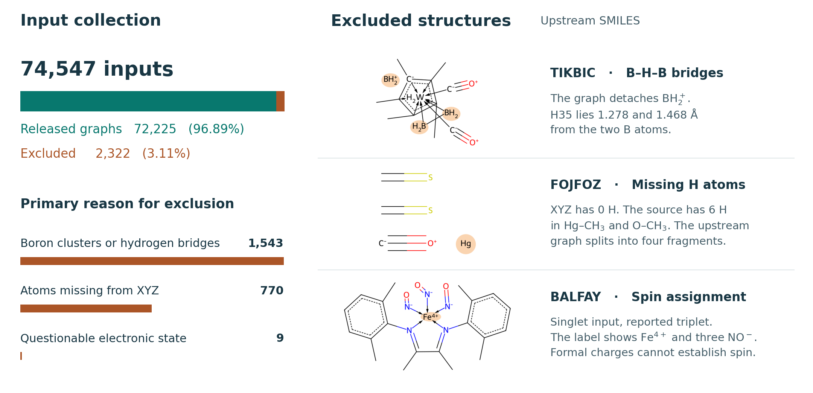
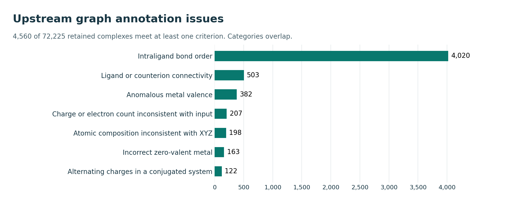

# tmQMg-Corrected

tmQMg-Corrected provides one **Lewis molecular graph for each of 72,225 transition-metal complexes** in tmQMg. The V3000 SDF files preserve the upstream XYZ atom order and coordinates and record explicit hydrogens, connectivity, bond orders, formal charges and coordination bonds. [SDF files](data/) · [File index and checksums](manifest.json) · [Release 2026-11-20 files](evidence/data.md#release-bundle)

The input comprises 74,547 CSD identifiers from the expanded release of tmQMg by Kneiding and colleagues. Starting from the coordinates, charge and input spin multiplicity, we checked primary reports and same-ID structure records, examined g-xTB Wiberg bond orders (WBOs) on the input geometry, and reviewed the Lewis assignments. Each graph carries its source, rationale and evidence tier. For the 23,393 tier-3 graphs, independent evidence for the complete graph is limited. The release gives one Lewis representation supported by the available evidence. [Upstream data at the pinned revision](https://github.com/uiocompcat/tmQMg/tree/e1dc9887b8f20a217a1db6ca972d726bcbaab45b/data) · [tmQMg paper](https://doi.org/10.1039/D2DD00129B) · [Annotation methods](evidence/methods.md)

## Boron clusters and problematic inputs in tmQMg

We excluded 1,543 complexes with a boron cluster or bridging hydrogen involving boron, for which a unique two-centre Lewis description is difficult to justify. Another 770 XYZ files lack atoms relative to the source composition. All missing atoms are hydrogen. For nine other inputs, the singlet multiplicity conflicts with a published assignment or remains uncertain. The chart counts each ID once by primary reason. The structures on the right show the upstream labels for three excluded inputs. [Exclusions and supporting sources by ID](evidence/tables/excluded-records.csv) · [FOJFOZ source structure](https://github.com/jensengroup/xyz2mol_tm/blob/db2734b084045ef895528c7a3d5040d38da23983/SMILES_csvs/csd_smiles.csv#L91294)



## Upstream annotation issues in the retained subset

We compared the upstream SMILES for each retained ID with its reference graph, ignoring metal coordination bonds and stereochemistry and accepting verified ligand resonance equivalence. Of 72,225 complexes, **66,706 were equivalent and 4,915 were inequivalent**. For 360 the comparison was inconclusive, 240 lacked an upstream SMILES, and four SMILES could not be parsed for scoring. [Full comparison results](evidence/tables/equivalence-rescore.csv)



Each category counts distinct CSD IDs. One complex can contribute to several categories. Each pair below was drawn with rdkit-dof on the same XYZ coordinates, with the upstream annotation on the left and the released graph on the right. [Counting criteria](evidence/results.md#upstream-annotation-issues) · [Issues by ID](evidence/tables/upstream-issue-types.csv) · [Example bond lengths and WBOs](evidence/tables/example-bonds.csv)

**Intraligand bond order · DEFWIY**

The upstream graph draws both alkynyl C–C bonds as single bonds and gives each Au-bound carbon a charge of −3. Both bonds measure 1.250 Å and have a WBO of 2.64. The original same-ID CSD connection table specifies two C≡C bonds. Restoring both triple bonds preserves the input composition and total charge of −1. [DEFWIY source connection table](https://github.com/jensengroup/xyz2mol_tm/blob/db2734b084045ef895528c7a3d5040d38da23983/SMILES_csvs/csd_smiles.csv#L48402)



**Ligand or counterion connectivity · JEGLOA**

A missing Se–C bond splits dimethyl selenide into CH₃Se⁻ and a detached CH₃⁻. Restoring the 1.954 Å bond (WBO 0.98) gives neutral CH₃–Se–CH₃.



**Anomalous metal valence · RAWVAN**

The upstream graph labels Ag as +7 and splits perchlorate into a Cl–O fragment of charge −1 and three isolated O²⁻ ions. Restoring the three missing Cl–O bonds gives perchlorate a total charge of −1 and Ag a formal charge of +1.



**Charge or electron count inconsistent with the input · ERULUB**

The input is neutral. The upstream graph has charge +2 and 300 electrons. Changing two S=O bonds at the same sulfur to S–O⁻ restores the input charge of zero and its count of 302 electrons.



**Atomic composition inconsistent with XYZ · ABEVAG**

XYZ contains 15 H atoms. Expanding the upstream SMILES gives 30. Each of five acetonitrile ligands is drawn as CH₃–CH₂–NH, adding three implicit hydrogens per ligand. The reference restores CH₃–C≡N, placing all 15 hydrogens on the five methyl groups.



**Incorrect zero-valent metal · SAZFEF**

The upstream graph draws both donor ends as C=S and assigns Ni a formal charge of zero. The same-ID structure supports C–S⁻ at both ends and a central C=C bond. The ligand then carries −2, giving Ni a formal charge of +2 in the neutral complex.



**Alternating charges in a conjugated system · CUDBOU**

In the six-membered ring enlarged below, the upstream charges along C10, C12, C14 and C16 are −1, +1, −1 and +1. The same-ID record supports alternating single and double bonds with all four carbons neutral.



## Validation and reproduction

The release checks cover all 74,547 inputs. The repository provides the extracted results of 72,628 g-xTB single points, including all reported atom-pair WBOs. The companion archive contains the 72,628 original run logs, indexed by CSD ID and calculation cohort with a SHA-256 digest for each log. We used the released XYZ and WBO data to recheck 3,935,782 nonmetal covalent bonds. Independent g-xTB runs for the seven illustrated complexes reproduced their WBO files byte for byte. [Log archive details](evidence/data.md#original-g-xtb-logs) · [Verification results](evidence/data.md#verification-of-the-2026-11-20-release)

From the repository root, the first command validates the data and recalculates the bond evidence. The second redraws the two overview plots and the seven graph pairs.

```bash
python3 scripts/validate.py
uv run --locked python scripts/figures.py
```

To rescore the seven examples, run `uv run --locked --extra scoring python scripts/rescore.py DEFWIY JEGLOA RAWVAN ERULUB ABEVAG SAZFEF CUDBOU`. Omit the IDs to rescore the full release. [Data format, evidence checks and packaging](evidence/data.md)

## Data license

The new Lewis annotations are licensed under **CC BY 4.0**. Credit tmQMg-Corrected, link the license, identify the version used, indicate any changes, and cite tmQMg. The upstream GitHub repository supplies an MIT license. The NIRD archive of tmQMg graph data specifies CC BY 4.0. [Attribution and license texts](sources/DATA-LICENSE.md) · [Upstream archive](https://doi.org/10.11582/2025.5if4m3y3)
